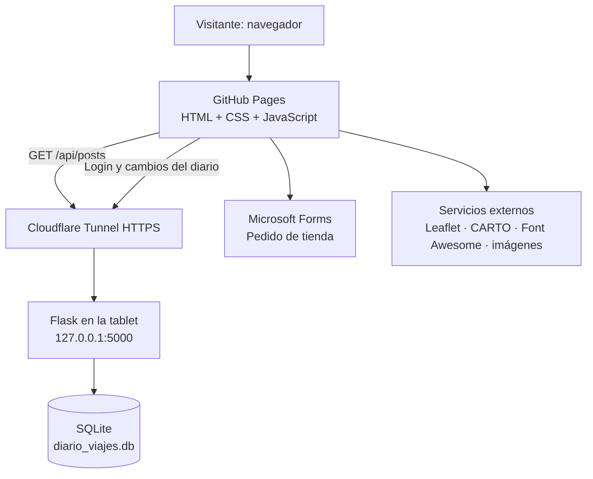

# Documentación técnica y guía de uso

**Proyecto:** Viaje a Japón 2027  
**Asignatura:** Tecnologías de la Información y la Comunicación (TIC)  
**Frontend público:** <https://srgusa15.github.io/Web_proyecto_viaje_tic/>  
**Versión de esta documentación:** octubre de 2026

> Esta documentación describe los archivos incluidos en esta entrega. Los horarios, vuelos y alojamientos son los datos de planificación presentes en el proyecto y se deben contrastar con las confirmaciones oficiales antes del viaje.

## 1. Qué es el proyecto

«Viaje a Japón 2027» es una web escolar que agrupa la información de un viaje de siete días. Combina un frontend estático publicado con GitHub Pages y una API independiente en Python/Flask que guarda las publicaciones del diario en SQLite, alojada en una tablet HP ElitePad y expuesta mediante Cloudflare Tunnel cuando el equipo y el túnel están activos.

La web no necesita un proceso de compilación: está construida con HTML, CSS y JavaScript. La cartografía usa Leaflet y teselas de CARTO; los iconos se cargan desde Font Awesome. Los pedidos de la tienda se completan por Microsoft Forms.

## 2. Páginas y funciones

| Archivo | Función principal |
|---|---|
| `index.html` | Portada visual, cuenta atrás y accesos rápidos al resto de la web. |
| `logistica.html` | Resumen de los vuelos y alojamientos planificados, más una lista de preparativos. |
| `itinerario.html` | Mapa interactivo de Tokio, Hakone, Kioto y Nara, y cronología del viaje. |
| `tienda.html` | Selección de artículos, cálculo del importe, resumen revisable y continuación en Microsoft Forms. |
| `blog.html` | Diario de viaje: búsqueda, filtros por categoría, ordenación, lectura completa, galería y panel de administración. |
| `proyecto-tic.html` | Resumen de arquitectura, herramientas y decisiones técnicas. |

Todas las páginas comparten una navegación adaptable, un selector de tema y un pie de página. La preferencia visual se guarda en `localStorage`; el menú móvil se gestiona mediante JavaScript. En la portada se ejecuta una cuenta atrás para el 1 de abril de 2027 a las 11:30 y un efecto sakura que se omite cuando el navegador solicita reducir las animaciones.

## 3. Diseño y estructura de archivos

```text
Web_proyecto_viaje_tic/
├── README.md
├── app.py
├── requirements.txt
├── .env.example
├── .gitignore
├── index.html
├── logistica.html
├── itinerario.html
├── tienda.html
├── blog.html
├── proyecto-tic.html
├── css/
│   ├── style.css
│   └── blog.css
└── js/
    ├── main.js
    ├── map.js
    ├── blog-config.js
    └── blog.js
```

- `css/style.css` contiene el sistema visual común: paleta, navegación, hero, superficies, tarjetas, cronología, tienda, temas y reglas responsive.
- `css/blog.css` mantiene los componentes específicos del diario (tarjetas de entradas, filtros, formularios, diálogos y galería).
- `js/main.js` controla la navegación móvil, tema, cuenta atrás, efecto sakura y resumen de cesta.
- `js/map.js` crea el mapa Leaflet y sus marcadores.
- `js/blog-config.js` contiene la URL pública base del backend. No debe contener contraseñas ni tokens.
- `js/blog.js` carga y filtra entradas y gestiona las acciones administrativas autenticadas.
- `app.py` define la API Flask, valida datos, gestiona sesiones administrativas y accede a SQLite.

## 4. Arquitectura



GitHub Pages solo sirve los archivos estáticos; no ejecuta Python. Flask y SQLite se ejecutan por separado en el equipo servidor. Si la tablet se apaga, entra en suspensión, pierde Internet o deja de funcionar el túnel, el diario remoto no estará disponible aunque las páginas estáticas sigan cargando.

## 5. Tienda: qué hace y qué no hace

La tienda tiene tres opciones de producto:

- Sudadera Sakura: 25 € por unidad, hasta dos unidades en el selector.
- Taza conmemorativa: 10 € por unidad, hasta dos unidades.
- Papeletas de sorteo: 3 € por papeleta; el selector ofrece 1, 5 o 10.

Al cambiar una selección, `calcTotal()` suma los precios seleccionados. Al pulsar **Revisar pedido**, la web abre un diálogo con los artículos y el total estimado. Desde ahí se puede copiar un resumen o continuar a Microsoft Forms.

**El diálogo es una revisión local del navegador, no un pedido registrado.** No envía datos personales, no reserva existencias y no cobra. El pedido definitivo y sus datos se introducen en Microsoft Forms. Para conectar la web con el formulario existente, `ORDER_FORM_URL` se define al principio de la lógica de tienda en `js/main.js`.

### Posibles mejoras posteriores

1. Si Microsoft Forms permite crear un enlace precompletado para los campos relevantes, se podría explorar que parte del resumen aparezca ya rellenado. Esto depende de las posibilidades y configuración del formulario actual; no se presupone que los parámetros de URL funcionen automáticamente.
2. Para una experiencia más completa sin pagos, se podría añadir una API `POST /api/orders` a Flask, guardar pedidos en SQLite con un identificador de pedido y crear un panel de administración para marcar estados como «recibido», «confirmado» y «entregado». Antes habría que decidir qué datos personales son estrictamente necesarios y cómo se protegerán.
3. Un pago real en línea requeriría una pasarela de pagos y una gestión adicional de seguridad, protección de datos, reembolsos y responsabilidades. Para un proyecto escolar, mantener el pago fuera de esta web y usar Forms es una opción más sencilla y controlable.

## 6. Configurar y ejecutar el backend

### 6.1. Requisitos

- Python compatible con el sistema del equipo servidor.
- Flask instalado en ese intérprete.
- Conexión a Internet para el túnel y los servicios externos.

En una terminal abierta dentro de la carpeta del proyecto:

```bash
python -m pip install Flask
```

Si el equipo emplea varias instalaciones de Python, utiliza el mismo intérprete para instalar Flask y ejecutar `app.py`.

### 6.2. Crear la configuración privada

Copia `.env.example` a un archivo llamado `.env` junto a `app.py`. Edita `.env` y configura, como mínimo:

```dotenv
ADMIN_PASSWORD=pon_aqui_una_contrasena_larga_y_unica
FRONTEND_ORIGINS=https://srgusa15.github.io
DATABASE_PATH=diario_viajes.db
```

La contraseña administrativa debe tener al menos 14 caracteres. Utiliza una contraseña única, no la incluyas en JavaScript ni en el repositorio. El archivo `.gitignore` de esta entrega evita añadir `.env` y los archivos de SQLite al control de versiones.

`FRONTEND_ORIGINS` debe contener el origen que usa la web pública —solo esquema, host y puerto si corresponde; no se incluye `/Web_proyecto_viaje_tic/blog.html`. Para desarrollo local pueden añadirse orígenes locales separados por comas, por ejemplo `http://localhost:8000,http://127.0.0.1:8000`.

Si `ADMIN_PASSWORD` no se configura, el endpoint de inicio de sesión devuelve un error indicando que la administración no está configurada. No dejes el panel administrativo operativo con una contraseña vacía.

### 6.3. Arrancar Flask

Desde la carpeta que contiene `app.py`:

```bash
python app.py
```

La aplicación escucha en `127.0.0.1`, puerto `5000`, con el modo de depuración desactivado. La primera ejecución crea `diario_viajes.db` y las tablas que necesita, o adapta de forma compatible la tabla `posts` para añadir el campo de categoría si la base era de una versión anterior.

En la propia tablet, prueba estas direcciones:

- Estado del servicio: <http://127.0.0.1:5000/api/health>
- Entradas: <http://127.0.0.1:5000/api/posts>

Si no hay entradas, la segunda dirección debe devolver `[]`. Mantén abierta la terminal de Flask. Para detener el servidor, usa `Ctrl+C`.

### 6.4. Arrancar el túnel

En otra terminal, con `cloudflared.exe` disponible, ejecuta:

```powershell
.\cloudflared.exe tunnel --url http://127.0.0.1:5000
```

Si el ejecutable está en otro directorio, utiliza su ruta real. Copia la URL HTTPS que muestra Cloudflare y manten la terminal del túnel abierta. Una URL de *Quick Tunnel* es temporal; puede cambiar cuando se reinicie el proceso y no implica una garantía de disponibilidad permanente.

### 6.5. Configurar la URL del frontend

Edita `js/blog-config.js`:

```javascript
window.BLOG_API_BASE_URL = "https://TU-URL-ACTUAL.trycloudflare.com";
```

**Importante: guarda solo el origen/base HTTPS; no añadas `/api/posts`.** `js/blog.js` concatena esa base con rutas como `/api/posts`, `/api/auth/login` y `/api/posts/ID`. Si el origen del túnel cambia, actualiza este archivo y vuelve a publicar el frontend.

Después, en el repositorio, confirma los cambios en la rama que publica GitHub Pages. Espera a que la publicación termine y recarga el navegador sin caché si sigues viendo la versión anterior.

## 7. API del diario

Las rutas implementadas por `app.py` son:

| Método | Ruta | Acceso | Propósito |
|---|---|---|---|
| `GET` | `/api/health` | Público | Comprobar que Flask responde. |
| `GET` | `/api/posts` | Público | Listar entradas, más recientes primero. |
| `GET` | `/api/posts/<id>` | Público | Consultar una entrada. |
| `POST` | `/api/auth/login` | Público, con límite de intentos | Validar la contraseña administrativa y devolver un token temporal. |
| `GET` | `/api/auth/me` | Token Bearer válido | Comprobar la sesión de administración. |
| `POST` | `/api/auth/logout` | Token Bearer válido | Cerrar la sesión. |
| `POST` | `/api/posts` | Token Bearer válido | Crear una entrada. |
| `PUT` | `/api/posts/<id>` | Token Bearer válido | Actualizar una entrada. |
| `DELETE` | `/api/posts/<id>` | Token Bearer válido | Eliminar una entrada. |

Los artículos tienen identificador, título, contenido, imagen opcional, fecha y categoría. El backend valida tipos, campos obligatorios y longitudes. Los tokens se generan aleatoriamente, se almacena su hash en SQLite y expiran a las ocho horas. La interfaz guarda el token de sesión en `sessionStorage`, no la contraseña.

### CORS

Flask añade cabeceras CORS solo para los orígenes incluidos en `FRONTEND_ORIGINS`. CORS limita qué páginas web pueden leer respuestas desde el navegador, pero **no es un sustituto de la autenticación** y no bloquea a cualquier cliente HTTP que intente llamar a la URL directamente. Las operaciones de escritura también exigen un token válido.

## 8. Publicar y probar los cambios

El frontend se aloja en GitHub Pages y se actualiza al confirmar los archivos en la rama configurada para la publicación.

Lista de comprobación recomendada después de actualizar:

- [ ] Abrir `index.html` y revisar la cuenta atrás, menú, tema y enlaces rápidos.
- [ ] Abrir `logistica.html` y comprobar la disposición de las tarjetas.
- [ ] Abrir `itinerario.html` y esperar a que el mapa cargue sus teselas; probar los cuatro marcadores.
- [ ] Abrir `tienda.html`, cambiar las tres opciones y comprobar el total.
- [ ] Abrir **Revisar pedido**, verificar el resumen, probar **Copiar resumen** y abrir Microsoft Forms.
- [ ] Abrir `blog.html`, comprobar que recupera entradas o muestra correctamente el estado vacío.
- [ ] Iniciar sesión en administración y comprobar que la publicación/edición/eliminación está disponible solo tras autenticarse.
- [ ] Abrir `proyecto-tic.html` y comprobar el enlace a la documentación y al repositorio.
- [ ] Probar el sitio en una pantalla móvil y en el tema claro y Tokyo Night.
- [ ] Confirmar que `.env` y la base de datos local no se han subido al repositorio.

## 9. Seguridad, privacidad y mantenimiento

- **No compartir `.env`:** contiene la contraseña de administración y configuración local.
- **No subir la base de datos:** puede incluir las publicaciones y los hashes de sesiones administrativas. Haz copias de seguridad privadas.
- **Protección del contenido:** el backend exige autenticación para escribir, utiliza consultas parametrizadas y valida los campos. La contraseña administrativa debe ser larga y única.
- **CORS:** configura el origen exacto de la web. Recuerda que CORS no autentica a los usuarios.
- **URL temporal:** el túnel Quick Tunnel puede cambiar de dirección o desconectarse.
- **Disponibilidad:** la tablet debe estar encendida, conectada a Internet y sin suspensión; Flask y Cloudflare deben continuar activos.
- **Imágenes:** la web acepta URL de imagen HTTPS públicas; no sube ficheros al servidor.
- **Dependencias externas:** mapas, iconos e imágenes pueden fallar si sus CDN o proveedores están caídos.
- **Tienda:** solo calcula y resume. La web no realiza cobros ni confirma la recepción del pedido.

Para actualizar el código del sitio, conserva los datos de `diario_viajes.db`, no reemplaces `.env` por una copia de ejemplo y guarda una copia privada de la base de datos antes de cambios que afecten al backend.

## 10. Tecnologías utilizadas

| Tecnología | Uso |
|---|---|
| HTML5 | Estructura semántica de las páginas. |
| CSS3 | Sistema visual, temas y diseño adaptable. |
| JavaScript | Navegación, cuenta atrás, tienda, mapa y comunicación con la API. |
| Python y Flask | Servidor y API del diario. |
| SQLite | Persistencia de entradas y sesiones. |
| Leaflet 1.9.4 + CARTO | Mapa interactivo. |
| Font Awesome 6.4 | Iconos. |
| GitHub Pages | Publicación estática del frontend. |
| Cloudflare Tunnel | Acceso HTTPS al backend alojado en la tablet. |
| Microsoft Forms | Captura final de datos de los pedidos. |

## 11. Conclusión

La versión rediseñada comparte una identidad visual en todas las páginas: navegación común, hero editorial, superficies suaves, acentos coral/cian, tarjetas coherentes y adaptación a móviles. Se mantienen las funciones principales del sitio y se mejora el flujo de la tienda con una pantalla de revisión y la posibilidad de copiar un resumen antes de completar el pedido en Microsoft Forms.

El sistema de diario permanece separado del frontend estático para conservar su persistencia y administración en el backend. La disponibilidad remota sigue dependiendo de la configuración real de Flask, de la contraseña y orígenes del archivo `.env`, y de que Cloudflare Tunnel esté activo.
