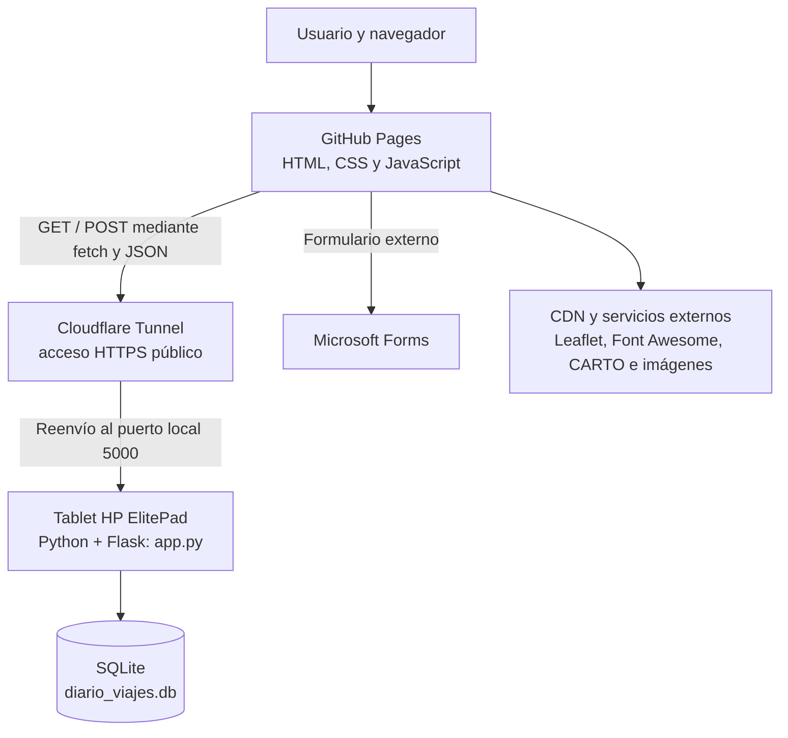

# Memoria técnica del proyecto web «Viaje a Japón 2027»

**Asignatura:** Tecnologías de la Información y la Comunicación (TIC)  
**Tipo de proyecto:** Aplicación web full-stack con alojamiento estático, API y base de datos local  
**Web pública:** <https://srgusa15.github.io/Web_proyecto_viaje_tic/index.html>    
**Fecha de documentación:** 12 de octubre de 2026

> Esta memoria describe la implementación a partir de los archivos del frontend y del backend `app.py` facilitados para el proyecto. Cuando una característica depende de servicios externos o de la configuración del equipo, se indica expresamente.

---

## Índice

1. [Introducción](#1-introducción)
2. [Objetivos](#2-objetivos)
3. [Descripción funcional](#3-descripción-funcional)
4. [Arquitectura del sistema](#4-arquitectura-del-sistema)
5. [Tecnologías utilizadas y justificación](#5-tecnologías-utilizadas-y-justificación)
6. [Estructura del proyecto](#6-estructura-del-proyecto)
7. [Base de datos](#7-base-de-datos)
8. [API del diario de viaje](#8-api-del-diario-de-viaje)
9. [Instalación y ejecución en local](#9-instalación-y-ejecución-en-local)
10. [Despliegue remoto](#10-despliegue-remoto)
11. [Pruebas de funcionamiento](#11-pruebas-de-funcionamiento)
12. [Seguridad, limitaciones y mejoras futuras](#12-seguridad-limitaciones-y-mejoras-futuras)
13. [Conclusión](#13-conclusión)

---

## 1. Introducción

«Viaje a Japón 2027» es una aplicación web desarrollada para el proyecto escolar de TIC. Su finalidad es centralizar la información de un viaje de fin de curso de siete días por Japón y ofrecer una interfaz accesible desde ordenadores, tabletas y móviles.

La web reúne información logística, un itinerario con mapa interactivo, una tienda de financiación escolar, una cuenta atrás y una sección de diario de viaje. El proyecto combina un frontend estático publicado mediante GitHub Pages con un backend independiente escrito en Python que utiliza Flask y SQLite para almacenar las entradas del diario.

Uno de los aspectos técnicos del proyecto es reutilizar una tablet HP ElitePad como equipo servidor de bajo consumo. El acceso remoto al backend se plantea mediante Cloudflare Tunnel, de forma que el navegador pueda realizar solicitudes HTTPS hacia la API sin publicar directamente un puerto del router doméstico. La disponibilidad efectiva de ese acceso depende de que el equipo, el servidor Flask y el túnel estén funcionando y de que la URL configurada en el frontend sea válida.

## 2. Objetivos

### 2.1. Objetivo general

Diseñar e implementar una aplicación web modular que centralice los contenidos del viaje escolar a Japón y demuestre la integración de tecnologías de cliente, servidor, comunicaciones y almacenamiento de datos.

### 2.2. Objetivos específicos

- Crear una interfaz web adaptable a distintos tamaños de pantalla.
- Organizar los contenidos del viaje en páginas diferenciadas y fáciles de navegar.
- Implementar funciones de JavaScript para la cuenta atrás, el tema visual, el menú móvil, el mapa y el cálculo de los pedidos.
- Mostrar un itinerario geolocalizado con Leaflet y cartografía de CARTO.
- Proporcionar un diario de viaje que permita publicar y consultar entradas desde una API HTTP.
- Guardar las entradas en una base de datos SQLite persistente en el equipo servidor.
- Publicar el frontend mediante GitHub Pages y separar el backend para poder alojarlo en hardware propio.
- Aplicar buenas prácticas de organización del código y documentar el procedimiento de instalación, ejecución y comprobación.
- Explorar la reutilización de hardware antiguo como alternativa económica para ejecutar servicios ligeros.

## 3. Descripción funcional

La aplicación contiene seis páginas principales:

| Página | Archivo | Funcionalidad |
|---|---|---|
| Inicio | `index.html` | Presentación del viaje, cuenta atrás hasta la fecha prevista de salida y efecto visual de pétalos de sakura. |
| Logística | `logistica.html` | Información planificada sobre los vuelos y los alojamientos. |
| Itinerario | `itinerario.html` | Mapa interactivo con marcadores para Tokio, Hakone, Kioto y Nara, además de una cronología por días. |
| Tienda | `tienda.html` | Selección de productos, cálculo del importe y acceso a un formulario externo de Microsoft Forms. |
| Blog | `blog.html` | Formulario para publicar entradas y contenedor para mostrar los artículos recuperados desde la API. |
| Panel TIC | `proyecto-tic.html` | Presentación de criterios de evaluación y de decisiones técnicas del proyecto. |

Todas las páginas comparten estilos, navegación y el conmutador de tema. En pantallas pequeñas, la navegación se convierte en un menú desplegable.

### Funciones del cliente

- **Cuenta atrás:** JavaScript calcula el tiempo restante hasta el 1 de abril de 2027 a las 11:30, según la fecha configurada en `js/main.js`.
- **Tema visual:** el modo «Tokyo Night» se activa mediante una clase CSS y se conserva con `localStorage`.
- **Menú adaptable:** un botón alterna la visibilidad de los enlaces en pantallas pequeñas.
- **Efecto sakura:** en la página de inicio se generan pétalos animados, que se eliminan del DOM tras un intervalo para limitar la acumulación de elementos.
- **Mapa:** `js/map.js` inicializa Leaflet y añade cuatro marcadores con ventanas emergentes.
- **Tienda:** `calcTotal()` suma las opciones elegidas y `sendOrder()` impide continuar si el importe es cero. El pedido se continúa en Microsoft Forms; la web no implementa por sí misma un sistema de pago.
- **Diario:** `js/blog.js` consulta la API para mostrar las entradas y envía nuevas publicaciones mediante solicitudes JSON.

## 4. Arquitectura del sistema

### 4.1. Visión general

La solución se divide en varios componentes con responsabilidades distintas. El frontend se sirve como contenido estático y el diario utiliza una API alojada por separado.



**Flujo del diario:** el navegador carga `blog.html` desde el alojamiento web y ejecuta `js/blog.js`. Este script hace peticiones a `API_URL`. El túnel debe dirigirlas al servidor Flask, que lee o escribe en `diario_viajes.db` y devuelve respuestas JSON. El script del navegador actualiza el contenido de la página con los datos recibidos.

### 4.2. Capa cliente: frontend

El frontend está compuesto por documentos HTML, una hoja de estilos compartida y scripts JavaScript. No requiere un proceso de compilación ni un framework de cliente. GitHub Pages distribuye los archivos estáticos por HTTPS.

La URL de la API está configurada en la constante `API_URL` de `js/blog.js`. En la copia de código facilitada apunta a:

```js
const API_URL = "https://midlands-msgid-auditor-dozens.trycloudflare.com/api/posts";
```

La URL de un túnel temporal puede cambiar o dejar de funcionar. Por tanto, esta constante debe coincidir con la URL pública vigente del túnel en el momento del despliegue.

### 4.3. Capa servidor: Flask

El archivo `app.py` crea una aplicación Flask y define una única ruta de API: `/api/posts`, que admite `GET`, `POST` y `OPTIONS`. Al ejecutar directamente el archivo, llama a `init_db()` y arranca Flask con estos parámetros:

- Dirección de escucha: `0.0.0.0`.
- Puerto: `5000`.
- Modo de depuración: desactivado (`debug=False`).

Escuchar en `0.0.0.0` permite aceptar conexiones dirigidas a las interfaces de red del equipo. La publicación real hacia Internet depende, además, de la configuración del túnel y de la conectividad de la tablet.

### 4.4. Capa de datos: SQLite

SQLite guarda las entradas en el archivo `diario_viajes.db`. No se necesita ejecutar un servidor de base de datos aparte: Python incluye el módulo `sqlite3`. El archivo se crea en el directorio de trabajo desde el que se ejecuta `app.py`, si todavía no existe.

### 4.5. Componentes externos

- **GitHub Pages:** alojamiento del frontend estático.
- **Cloudflare Tunnel:** pasarela remota prevista entre la URL HTTPS y el servicio local.
- **Leaflet y CARTO:** bibliotecas y teselas cartográficas.
- **Font Awesome y Unsplash:** iconos e imágenes cargados desde servicios externos.
- **Microsoft Forms:** formulario de recogida de pedidos de la tienda.

Estos componentes requieren conexión a Internet y están sujetos a su disponibilidad y condiciones de uso.

## 5. Tecnologías utilizadas y justificación

| Tecnología | Función | Justificación en el proyecto |
|---|---|---|
| HTML5 | Estructura de las páginas | Permite separar el contenido por páginas y utilizar elementos semánticos como navegación, secciones y pie de página. |
| CSS3 | Diseño y presentación | Las variables CSS centralizan la paleta y los temas. Flexbox, Grid y media queries facilitan la adaptación a distintas pantallas. |
| JavaScript ES6 | Interactividad del navegador | Implementa la cuenta atrás, los temas, el menú móvil, los efectos visuales, la lógica de la tienda y las llamadas a la API. |
| Python 3 | Lenguaje del backend | Permite construir un servicio sencillo y utilizar `sqlite3` sin instalar un motor de base de datos separado. |
| Flask | Servidor HTTP y API | Define la ruta de la API, procesa solicitudes y devuelve respuestas JSON con poco código adicional. |
| SQLite | Persistencia | Guarda los artículos en un archivo local y es suficiente para el alcance de este proyecto. |
| `fetch()` y JSON | Comunicación entre cliente y servidor | Permiten recuperar entradas y enviar publicaciones de forma asíncrona sin recargar manualmente toda la página. |
| Leaflet 1.9.4 | Mapa interactivo | Proporciona mapas, marcadores y ventanas emergentes mediante JavaScript. |
| CARTO Voyager | Mapa base | Proporciona las teselas cartográficas visualizadas por Leaflet. |
| Font Awesome 6.4 | Iconografía | Unifica los iconos de navegación y de las distintas secciones mediante CDN. |
| `localStorage` | Preferencia visual | Recuerda el tema elegido en el navegador entre visitas. |
| Git y GitHub Pages | Versionado y publicación | Git permite mantener el código fuente y GitHub Pages publica el frontend estático. |
| Cloudflare Tunnel | Acceso remoto al backend | Permite exponer un servicio local mediante una URL HTTPS sin abrir directamente un puerto de entrada en el router. Debe estar configurado y activo para que el acceso remoto funcione. |
| Microsoft Forms | Recepción de pedidos | Delegar el formulario evita implementar almacenamiento y tratamiento propio de los pedidos dentro de esta web. |

### Decisiones de diseño

- **Separación por responsabilidades:** el HTML contiene la estructura, `style.css` centraliza la presentación y los archivos JavaScript agrupan la lógica funcional.
- **Sin framework de frontend:** reduce las dependencias de desarrollo y facilita la lectura del código en un proyecto escolar.
- **Backend pequeño:** Flask solo resuelve las necesidades del diario, en lugar de añadir una plataforma de servidor más compleja.
- **Persistencia local:** SQLite permite mantener las entradas aunque se reinicie el proceso, siempre que se conserve el archivo de base de datos.
- **Alojamiento independiente:** la web pública no necesita ejecutarse en la misma máquina que la API.

## 6. Estructura del proyecto

La estructura combinada del frontend y el backend es la siguiente:

```text
Web_proyecto_viaje_tic/
├── app.py                  # API Flask y creación de la base de datos
├── diario_viajes.db        # Base de datos generada al iniciar el backend
├── index.html              # Página principal y cuenta atrás
├── logistica.html          # Información de vuelos y alojamientos
├── itinerario.html         # Mapa y cronología del viaje
├── tienda.html             # Tienda y enlace a Microsoft Forms
├── blog.html               # Interfaz del diario
├── proyecto-tic.html       # Panel y ficha técnica del proyecto
├── css/
│   └── style.css           # Estilos, temas y diseño adaptable
├── js/
│   ├── main.js             # Lógica común, cuenta atrás y tienda
│   ├── map.js              # Inicialización del mapa
│   └── blog.js             # Lectura y publicación en la API
└── README.md               # Descripción general del repositorio
```

`diario_viajes.db` se genera en tiempo de ejecución; no es necesario crearlo manualmente. Es recomendable no sobrescribirlo al actualizar el código. La ubicación exacta depende del directorio de trabajo desde el que se ejecute `app.py`.

## 7. Base de datos

### 7.1. Motor y creación

El backend utiliza SQLite a través del módulo estándar `sqlite3`. La función `init_db()` ejecuta `CREATE TABLE IF NOT EXISTS`, por lo que crea la tabla si falta y conserva la existente si ya está creada. La inicialización se ejecuta al arrancar `app.py` directamente.

### 7.2. Tabla `posts`

| Campo | Tipo | Restricciones y valor | Descripción |
|---|---|---|---|
| `id` | `INTEGER` | `PRIMARY KEY AUTOINCREMENT` | Identificador único autoincremental. |
| `titulo` | `TEXT` | `NOT NULL` | Título de la entrada. |
| `contenido` | `TEXT` | `NOT NULL` | Texto principal de la entrada. |
| `imagen` | `TEXT` | Admite `NULL` | URL o cadena asociada a la imagen. La aplicación cliente espera una URL directa a una imagen. |
| `fecha` | `TIMESTAMP` | `DEFAULT CURRENT_TIMESTAMP` | Fecha y hora asignadas por SQLite al crear la entrada. |

### 7.3. Inserción y consulta

El endpoint `POST /api/posts` inserta `titulo`, `contenido` e `imagen`. La sentencia SQL utiliza parámetros (`?`) para los valores insertados, en vez de concatenarlos directamente a la consulta. El campo `fecha` no se incluye en el `INSERT`, ya que tiene un valor predeterminado.

El endpoint `GET /api/posts` devuelve las columnas `id`, `titulo`, `contenido`, `imagen` y `fecha`, ordenadas por fecha descendente. De este modo, las entradas más recientes aparecen primero.

La base de datos no define actualmente usuarios, autenticación, categorías, edición ni eliminación de entradas.

## 8. API del diario de viaje

### 8.1. Resumen de endpoints

La API implementada en `app.py` expone la siguiente ruta:

| Método | Ruta | Función | Respuesta habitual |
|---|---|---|---|
| `GET` | `/api/posts` | Recupera todas las entradas, de la más reciente a la más antigua. | `200 OK`, array JSON. |
| `POST` | `/api/posts` | Crea una nueva entrada a partir de datos JSON. | `201 Created` si se guarda correctamente. |
| `OPTIONS` | `/api/posts` | Responde a la petición de comprobación previa que puede enviar el navegador por CORS. | `200 OK`, `{"status":"ok"}`. |

La URL completa depende del entorno. En local, la base es `http://127.0.0.1:5000`; desde el frontend público se utiliza la URL HTTPS que proporcione el túnel.

### 8.2. `GET /api/posts`

**Finalidad:** listar las entradas guardadas.

**Parámetros:** no requiere parámetros de consulta.

**Respuesta satisfactoria:** `200 OK` con un array JSON. Cada elemento incluye los campos siguientes:

```json
[
  {
    "id": 1,
    "titulo": "Llegada a Tokio",
    "contenido": "Hoy hemos comenzado el recorrido por la ciudad.",
    "imagen": "https://ejemplo.com/imagen.jpg",
    "fecha": "2026-10-12 18:30:00"
  }
]
```

Los valores del ejemplo son ilustrativos; la fecha y los contenidos reales dependen de los registros almacenados. Cuando no hay entradas, la respuesta es un array vacío (`[]`). El frontend muestra un mensaje indicando que el diario está vacío.

**Errores:** si se produce una excepción durante la lectura, el backend devuelve `500 Internal Server Error` con un objeto JSON que contiene la clave `error`.

### 8.3. `POST /api/posts`

**Finalidad:** añadir una nueva entrada al diario.

**Cabecera esperada:** `Content-Type: application/json`.

**Cuerpo de la petición:**

```json
{
  "titulo": "Primer día en Japón",
  "contenido": "Hemos visitado Asakusa y el templo Senso-ji.",
  "imagen": "https://ejemplo.com/tokio.jpg"
}
```

Los campos obligatorios en el backend son `titulo` y `contenido`. `imagen` es opcional; si no se envía, el servidor utiliza una cadena vacía. El backend comprueba que los campos obligatorios existan en el objeto recibido, pero no valida actualmente que las cadenas tengan contenido no vacío ni comprueba que la URL de imagen sea válida. La llamada a `request.get_json()` depende además de que la petición esté correctamente codificada como JSON; Flask puede rechazar un JSON mal formado o un tipo de contenido incorrecto antes de llegar a la validación personalizada.

**Respuesta satisfactoria:** `201 Created`.

```json
{
  "status": "success"
}
```

**Errores contemplados por el código y por el procesamiento HTTP de Flask:**

| Estado HTTP | Motivo | Ejemplo de respuesta |
|---|---|---|
| `400 Bad Request` | Faltan datos obligatorios o Flask rechaza una petición JSON mal formada. | Si el cuerpo llega como un objeto vacío o sin campos obligatorios: `{"error":"Faltan datos"}`. En errores de análisis, la respuesta puede ser la generada por Flask. |
| `415 Unsupported Media Type` | En versiones de Flask que aplican esta validación, se llama a `request.get_json()` sin un tipo de contenido JSON válido. | Respuesta generada por Flask. |
| `500 Internal Server Error` | Se produce una excepción durante la escritura en SQLite. | `{"error":"..."}` |

El código transmite el texto de la excepción en el campo `error`. En una versión para uso público convendría registrar el detalle en el servidor y devolver al cliente un mensaje genérico.

### 8.4. `OPTIONS /api/posts` y CORS

La aplicación incorpora un manejador `@app.after_request` que añade estas cabeceras a las respuestas:

- `Access-Control-Allow-Origin: *`
- `Access-Control-Allow-Headers: Content-Type`
- `Access-Control-Allow-Methods: GET, POST, OPTIONS`

La ruta responde a `OPTIONS` con `200 OK` y `{"status":"ok"}`. Estas cabeceras facilitan que el frontend alojado en un dominio diferente pueda llamar a la API desde el navegador.

La política `Access-Control-Allow-Origin: *` permite peticiones desde cualquier origen compatible con CORS. CORS no es un mecanismo de autenticación: no impide que otros clientes HTTP llamen directamente a la API.

### 8.5. Ejemplos de uso desde terminal

Con Flask arrancado en el mismo equipo, la lista de entradas se puede consultar con:

```bash
curl http://127.0.0.1:5000/api/posts
```

Para crear una entrada:

```bash
curl -X POST http://127.0.0.1:5000/api/posts \
  -H "Content-Type: application/json" \
  -d '{"titulo":"Prueba","contenido":"Entrada de prueba","imagen":""}'
```

En algunas versiones de Windows, puede ser necesario ejecutar `curl.exe` y adaptar las comillas a la terminal utilizada.

## 9. Instalación y ejecución en local

### 9.1. Requisitos

- Python instalado en el equipo y compatible con la versión de Flask disponible.
- Git, si se va a clonar el repositorio.
- Navegador web actualizado.
- Conexión a Internet para cargar las bibliotecas, teselas e imágenes externas.
- Flask para ejecutar la API. `sqlite3` ya forma parte de la biblioteca estándar de Python.

El código fuente proporcionado no fija una versión exacta de Python ni incluye un archivo `requirements.txt`; por ello, se recomienda verificar la versión instalada y registrar las dependencias del entorno al preparar una instalación reproducible.

### 9.2. Obtener el código

Si se parte del repositorio publicado:

```bash
git clone https://github.com/SrGusa15/Web_proyecto_viaje_tic.git
cd Web_proyecto_viaje_tic
```

Asegúrate de que `app.py` está en el directorio raíz junto a los archivos HTML. Si se ha entregado por separado, copia el archivo en ese directorio antes de continuar.

### 9.3. Crear un entorno e instalar Flask

En Windows, desde la carpeta del proyecto, abre PowerShell o CMD y ejecuta:

```powershell
py -m venv .venv
.\.venv\Scripts\Activate.ps1
python -m pip install --upgrade pip
python -m pip install Flask
```

Si PowerShell no permite activar el entorno por la política de ejecución, se puede abrir CMD y utilizar:

```bat
.venv\Scripts\activate.bat
```

En Linux o macOS, los comandos equivalentes son:

```bash
python3 -m venv .venv
source .venv/bin/activate
python -m pip install --upgrade pip
python -m pip install Flask
```

Estos comandos instalan Flask en el entorno virtual del proyecto. La compatibilidad exacta depende de la versión y arquitectura de Python disponible en la tablet; si se utiliza un sistema de 32 bits, hay que verificar que el intérprete y los paquetes instalados sean compatibles con esa arquitectura.

### 9.4. Arrancar el backend

Desde el directorio que contiene `app.py`, con el entorno virtual activado:

```bash
python app.py
```

Al ejecutar el archivo, se llama a `init_db()` y se crea `diario_viajes.db` si no existe. Flask comienza a escuchar en el puerto `5000` y con la dirección `0.0.0.0`.

Para comprobar la API en ese equipo, abre:

<http://127.0.0.1:5000/api/posts>

La respuesta debe ser un array JSON. Si todavía no hay publicaciones, debe aparecer `[]`. Mantén esta terminal abierta mientras uses el backend; para detenerlo, pulsa `Ctrl+C`.

### 9.5. Arrancar el frontend en local

Abre una segunda terminal desde el directorio raíz del repositorio y ejecuta:

```bash
python -m http.server 8000
```

A continuación, abre:

<http://127.0.0.1:8000/index.html>

También se pueden abrir los otros archivos HTML desde el mismo servidor local. Es preferible utilizar el servidor HTTP en lugar de abrir directamente los archivos mediante `file://`, especialmente al probar solicitudes `fetch()`.

### 9.6. Configurar el frontend para usar la API local

Para probar el blog enteramente en un solo ordenador, cambia temporalmente la constante `API_URL` al principio de `js/blog.js` a:

```js
const API_URL = "http://127.0.0.1:5000/api/posts";
```

Guarda el archivo y recarga `blog.html`. Esta dirección solo es válida cuando el navegador y Flask se ejecutan en el mismo ordenador. En un dispositivo distinto, `127.0.0.1` apunta a ese propio dispositivo, no a la tablet servidor.

Para recuperar el acceso remoto publicado, vuelve a colocar en `API_URL` la dirección HTTPS vigente de Cloudflare Tunnel.

## 10. Despliegue remoto

El despliegue se divide entre el frontend público y el backend alojado en la tablet.

### 10.1. Publicar el frontend

1. Guarda los cambios de HTML, CSS y JavaScript en el repositorio Git.
2. Comprueba que `API_URL` contiene la URL pública actual del túnel y que no se ha dejado la URL de `localhost` usada durante las pruebas.
3. Sube los cambios a la rama configurada para GitHub Pages, que según el README del proyecto es `main`.
4. Abre la URL pública y verifica las páginas principales. GitHub Pages sirve el contenido estático; no ejecuta `app.py`.

### 10.2. Mantener el backend en la tablet

1. Conecta la HP ElitePad a una red con acceso a Internet.
2. Abre el directorio del proyecto y activa su entorno de Python.
3. Ejecuta `python app.py` y comprueba localmente `http://127.0.0.1:5000/api/posts`.
4. Mantén el equipo despierto y evita que entre en suspensión mientras tenga que atender solicitudes. La pantalla puede permanecer apagada si la configuración del sistema lo permite.
5. Comprueba que Cloudflare Tunnel está ejecutándose y reenvía el tráfico al servicio local de Flask en `http://127.0.0.1:5000`.
6. Si el túnel proporciona una URL distinta de la configurada en `js/blog.js`, actualiza `API_URL`, publica el cambio del frontend y vuelve a probar la sección del blog.

Si se utiliza `cloudflared.exe` para crear un túnel temporal desde Windows, un comando habitual es:

```powershell
.\cloudflared.exe tunnel --url http://localhost:5000
```

Este comando presupone que el ejecutable está en el directorio actual o que se ha indicado su ruta correcta. La URL temporal que muestre el proceso debe utilizarse como base de `API_URL`, añadiendo `/api/posts`. Una URL temporal puede cambiar en la siguiente ejecución; para un servicio estable se necesita configurar el tipo de túnel y el nombre de dominio correspondientes.

### 10.3. Comprobación final desde otro dispositivo

Desde un ordenador o móvil diferente, abre la web de GitHub Pages y entra en **Blog**. Comprueba que se cargan las entradas existentes y publica una entrada de prueba. Si se guarda correctamente, debería aparecer al actualizar la lista. Para confirmar la persistencia, reinicia Flask y vuelve a consultar las entradas: deben seguir presentes mientras no se elimine o sustituya `diario_viajes.db`.

**Importante:** disponer de una URL escrita en el código no demuestra por sí solo que el túnel esté activo. El acceso remoto solo funciona si Flask está ejecutándose, el túnel apunta al puerto correcto y la URL es válida en ese momento.

## 11. Pruebas de funcionamiento

| Prueba | Procedimiento | Resultado esperado |
|---|---|---|
| Inicialización de base de datos | Ejecutar `python app.py` sin una base de datos previa. | Se crea `diario_viajes.db` y la tabla `posts`. |
| Consulta sin entradas | Abrir `http://127.0.0.1:5000/api/posts` en un navegador. | `200 OK` con `[]`. |
| Crear una entrada válida | Enviar un `POST` con `titulo` y `contenido`. | `201 Created` y `{"status":"success"}`. |
| Comprobar persistencia | Detener y reiniciar el proceso Flask y repetir el `GET`. | La entrada sigue almacenada. |
| Validación de campos | Enviar un `POST` sin `titulo` o sin `contenido`. | `400 Bad Request` con `{"error":"Faltan datos"}`. |
| Mapa | Abrir `itinerario.html` con acceso a Internet. | Aparece el mapa y sus cuatro marcadores, si CARTO y los recursos externos están disponibles. |
| Preferencia de tema | Cambiar de tema y navegar a otra página del sitio. | Se conserva la elección en el mismo navegador. |
| Cálculo de tienda | Seleccionar varios productos. | El total se actualiza con la suma de las opciones. |
| Conexión remota del blog | Abrir la web pública con la tablet y el túnel activos. | El navegador consigue leer y publicar entradas mediante la API. |

## 12. Seguridad, limitaciones y mejoras futuras

### 12.1. Consideraciones de seguridad

- **API sin autenticación:** `app.py` no exige usuario ni contraseña. Si el túnel es accesible públicamente, cualquier cliente que conozca la URL podría intentar leer o crear publicaciones. Para un uso real sería necesario incorporar autenticación y controles de acceso.
- **CORS abierto:** `Access-Control-Allow-Origin: *` facilita pruebas, pero permite que cualquier origen web compatible intente acceder a la API. Cuando se estabilice el despliegue, conviene limitar los orígenes autorizados.
- **Inserción de HTML en el blog:** `js/blog.js` construye artículos mediante `innerHTML` con datos recibidos del servidor. Si el contenido incluye HTML o JavaScript malicioso, puede producirse una vulnerabilidad de tipo XSS. Es preferible insertar título y texto mediante `textContent` y crear los elementos DOM por separado; las URL de imagen también deben validarse.
- **Validación limitada:** el backend verifica la presencia de `titulo` y `contenido`, pero no impone límites de longitud, no comprueba que no estén vacíos y no valida el formato de `imagen`.
- **Información de errores:** las excepciones se incluyen en la respuesta JSON con un estado `500`. En una versión endurecida conviene no revelar detalles internos al cliente y registrar los errores en el servidor.
- **Servidor de desarrollo:** `app.run()` es apropiado para pruebas y un proyecto escolar de alcance reducido, pero no sustituye a un servidor WSGI de producción si el servicio necesita disponibilidad y robustez mayores.
- **Secretos y claves en el frontend:** los valores incluidos en JavaScript público pueden ser leídos por cualquier visitante. No deben incluirse contraseñas, tokens privados ni credenciales de servidor en el repositorio.

### 12.2. Limitaciones operativas

- El servidor depende de que la tablet esté encendida, conectada y sin suspensión del sistema.
- Un túnel temporal puede cambiar de URL o finalizar; `API_URL` debe reflejar la URL activa.
- La base de datos se guarda en un archivo local. Hay que hacer copias de seguridad de `diario_viajes.db` para evitar perder las publicaciones.
- El frontend depende de servicios externos para cartografía, iconos e imágenes, por lo que parte de la interfaz puede degradarse si esos servicios no están disponibles.
- La tienda calcula importes en el navegador y redirige a Microsoft Forms; no implementa procesamiento de pagos ni un backend propio para registrar pedidos.
- El archivo `README.md` original describe el blog como «en preparación». La presencia de `app.py` y de las llamadas `GET`/`POST` en `js/blog.js` indica que el código de integración existe, pero la operación real debe comprobarse con el servidor y el túnel activos.

### 12.3. Mejoras propuestas

1. Añadir autenticación o un mecanismo sencillo de autorización para crear publicaciones.
2. Restringir CORS al dominio del frontend desplegado.
3. Sustituir la inserción de contenido con `innerHTML` por creación segura de elementos DOM.
4. Validar tipos, longitudes y contenido de los campos recibidos por la API, incluida la URL de imagen.
5. Añadir un archivo `requirements.txt` y documentar la versión de Python usada para reproducir la instalación.
6. Crear copias de seguridad automáticas de la base de datos y probar el procedimiento de restauración.
7. Configurar un túnel estable para evitar editar la URL pública cada vez que se reinicie uno temporal.
8. Añadir registros de actividad, mensajes de error más claros y pruebas automatizadas de la API.
9. Considerar paginación o filtrado cuando el diario acumule muchas entradas.

## 13. Conclusión

El proyecto «Viaje a Japón 2027» reúne una interfaz web estática, funcionalidades interactivas en JavaScript y un servicio de backend desarrollado con Flask. La API permite consultar y crear entradas del diario, mientras SQLite proporciona persistencia local sin necesidad de administrar un motor de base de datos independiente. GitHub Pages y Cloudflare Tunnel separan el alojamiento del cliente y el servidor, y la reutilización de la tablet como equipo servidor demuestra una aplicación práctica de los conceptos de arquitectura web y sostenibilidad del hardware.

La implementación ya contiene la ruta principal de la API, el esquema de almacenamiento y la comunicación del frontend con el backend. Para que el servicio remoto sea fiable, es importante comprobar la URL real del túnel, mantener activa la tablet y aplicar las mejoras de seguridad señaladas antes de utilizarlo con información sensible o dejarlo abierto a Internet.

---

**Fin de la memoria técnica**  
*Proyecto escolar de Tecnologías de la Información y la Comunicación (TIC) · Viaje a Japón 2027*
